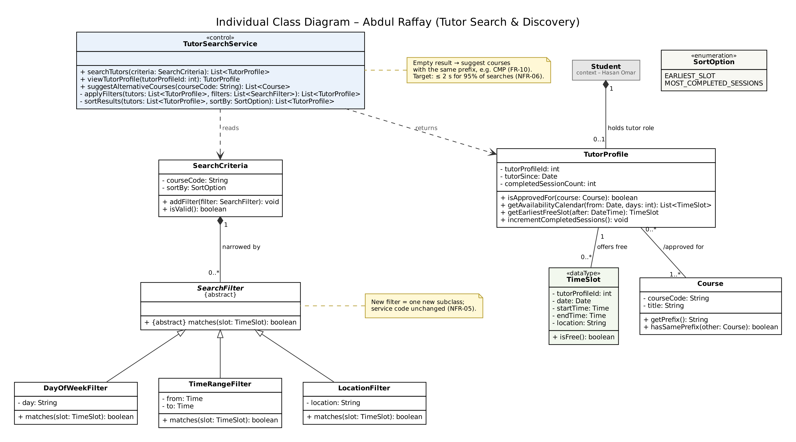

# Individual Class Inventory — Abdul Raffay

**AUS ID:** B00100018  
**Component:** Tutor search and discovery  
**Source:** TutorBook Lab 5 report, Part A, Exercise 1 (Section 1.2).  
**Status:** Individual/pre-integration model; see `../../Integration_Notes.md` for team-level changes.

| Class ID | Class Name | Purpose / Responsibility | Related Use Case(s) | Contributor |
| --- | --- | --- | --- | --- |
| AR-01 | Course | AUS course (e.g., CMP 305) used for applications, approvals, interests and search. | UC-06, UC-10 | Abdul Raffay |
| AR-02 | TutorProfile | The Tutor role of a student account: approved courses, public calendar, completed-session count. | UC-06, UC-08, UC-09 | Abdul Raffay |
| AR-03 | SearchCriteria | One tutor search request: course code, optional filters and sort order; validated before use. | UC-06–UC-08 | Abdul Raffay |
| AR-04 | SearchFilter {abstract} | Generalisation of the optional result filters, so a new filter is one new subclass. | UC-07 | Abdul Raffay |
| AR-05 | DayOfWeekFilter | Keeps tutors with a free slot on the chosen weekday. | UC-07 | Abdul Raffay |
| AR-06 | TimeRangeFilter | Keeps tutors with a free slot inside the chosen time range. | UC-07 | Abdul Raffay |
| AR-07 | LocationFilter | Keeps tutors with a free slot at the chosen location. | UC-07 | Abdul Raffay |
| AR-08 | TimeSlot «dataType» | A dated free slot of a tutor shown on the 14-day calendar. | UC-09 | Abdul Raffay |
| AR-09 | TutorSearchService «control» | Implements DFD process P2: approved-tutor search, filtering, sorting and same-prefix suggestions. | UC-06–UC-10 | Abdul Raffay |
| AR-10 | SortOption «enumeration» | Search sort order. | UC-08 | Abdul Raffay |

## Individual class diagram

Diagram image extracted from Figure 2 of the provided Lab 5 report. Refer to `Class_Diagram.md` for a GitHub-rendered Mermaid reconstruction, or the `.dot`/`.svg` files for Graphviz-based viewing and editing.
