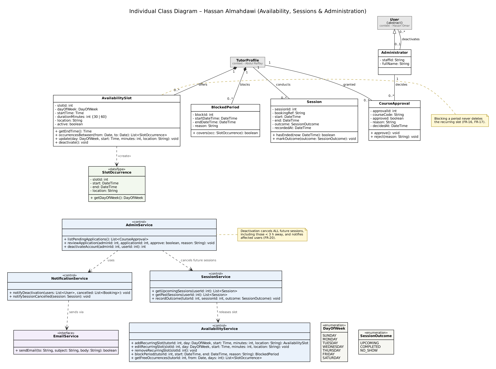

# Individual Class Inventory — Hassan Almahdawi

**AUS ID:** b00102063  
**Component:** Availability, sessions and administration  
**Source:** TutorBook Lab 5 report, Part A, Exercise 1 (Section 1.4).  
**Status:** Individual/pre-integration model; see `../../Integration_Notes.md` for team-level changes.

| Class ID | Class Name | Purpose / Responsibility | Related Use Case(s) | Contributor |
| --- | --- | --- | --- | --- |
| HA-01 | AvailabilitySlot | A tutor's recurring weekly slot with fixed length and location. | UC-16 | Hassan Almahdawi |
| HA-02 | BlockedPeriod | A date/time range a tutor marks unavailable without deleting recurring slots. | UC-17 | Hassan Almahdawi |
| HA-03 | SlotOccurrence «dataType» | One dated instance of a recurring slot, as shown on the 14-day calendar and selected for booking. | UC-16, UC-17 | Hassan Almahdawi |
| HA-04 | AvailabilityService «control» | Implements DFD process P3: recurring slots, blocked periods and free-slot calculation. | UC-16, UC-17 | Hassan Almahdawi |
| HA-05 | Session | A held tutoring session with its outcome (Completed / No-show). | UC-18, UC-19 | Hassan Almahdawi |
| HA-06 | SessionOutcome «enumeration» | UPCOMING, COMPLETED, NO_SHOW. | UC-19 | Hassan Almahdawi |
| HA-07 | SessionService «control» | Upcoming/past session dashboards and outcome recording. | UC-18, UC-19 | Hassan Almahdawi |
| HA-08 | CourseApproval | An administrator's approve/reject decision for one tutor and course. | UC-20 | Hassan Almahdawi |
| HA-09 | Administrator | Staff account performing approvals and deactivations. | UC-20, UC-21 | Hassan Almahdawi |
| HA-10 | AdminService «control» | Implements DFD process P6: per-course tutor approval and account deactivation. | UC-20, UC-21 | Hassan Almahdawi |
| HA-11 | NotificationService «control» | Composes deactivation and cancellation notices. | UC-21 | Hassan Almahdawi |
| HA-12 | EmailService «interface» | Boundary to the external Email Service actor from the use case model. | UC-21 | Hassan Almahdawi |
| HA-13 | DayOfWeek «enumeration» | Weekday of a recurring slot or filter. | UC-16 | Hassan Almahdawi |

## Individual class diagram

Diagram image extracted from Figure 4 of the provided Lab 5 report. Refer to `Class_Diagram.md` for a GitHub-rendered Mermaid reconstruction, or the `.dot`/`.svg` files for Graphviz-based viewing and editing.
