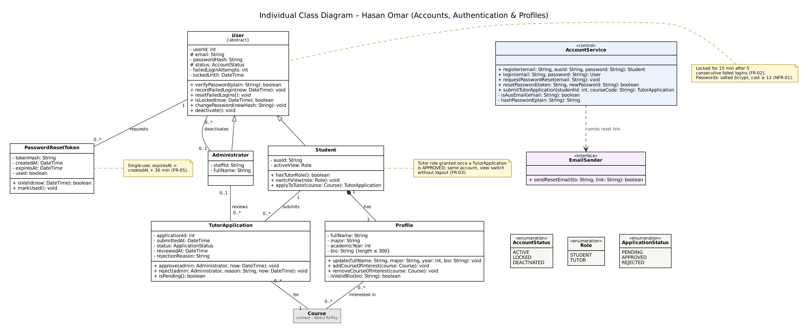

# Individual Class Inventory — Hasan Omar

**AUS ID:** b00100248  
**Component:** Accounts, authentication and profiles  
**Source:** TutorBook Lab 5 report, Part A, Exercise 1 (Section 1.1).  
**Status:** Individual/pre-integration model; see `../../Integration_Notes.md` for team-level changes.

| Class ID | Class Name | Purpose / Responsibility | Related Use Case(s) | Contributor |
| --- | --- | --- | --- | --- |
| HO-01 | User {abstract} | Abstract account holding credentials, account status and lock-out state shared by every login. | UC-02, UC-03 | Hasan Omar |
| HO-02 | Student | AUS student account; can gain the Tutor role and switch views without logging out. | UC-01, UC-05 | Hasan Omar |
| HO-03 | Administrator | Staff account that signs in with the same credentials mechanism but has no student functions. | UC-02 | Hasan Omar |
| HO-04 | Profile | Editable personal details and courses of interest of a student account. | UC-04 | Hasan Omar |
| HO-05 | PasswordResetToken | Single-use reset link token that expires 30 minutes after it is issued. | UC-03 | Hasan Omar |
| HO-06 | TutorApplication | A student's application to tutor one course, with status and rejection reason. | UC-05 | Hasan Omar |
| HO-07 | AccountService «control» | Implements DFD process P1: registration rules, login lock-out, password reset, tutor applications. | UC-01–UC-05 | Hasan Omar |
| HO-08 | EmailSender «interface» | Sends the password-reset link e-mail. | UC-03 | Hasan Omar |
| HO-09 | AccountStatus «enumeration» | Account state used for lock-out and deactivation. | UC-02 | Hasan Omar |
| HO-10 | Role «enumeration» | View a student account is currently using. | UC-05 | Hasan Omar |
| HO-11 | ApplicationStatus «enumeration» | Tutor application state. | UC-05 | Hasan Omar |

## Individual class diagram

Diagram image extracted from Figure 1 of the provided Lab 5 report. Refer to `Class_Diagram.md` for a GitHub-rendered Mermaid reconstruction, or the `.dot`/`.svg` files for Graphviz-based viewing and editing.
