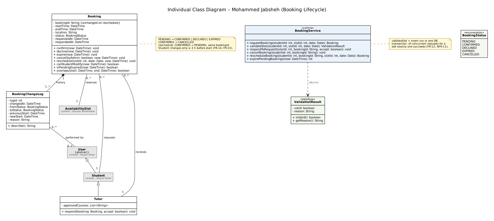

# Individual Class Inventory — Mohammed Jabsheh

**AUS ID:** b00097438  
**Component:** Booking lifecycle  
**Source:** TutorBook Lab 5 report, Part A, Exercise 1 (Section 1.3).  
**Status:** Individual/pre-integration model; see `../../Integration_Notes.md` for team-level changes.

| Class ID | Class Name | Purpose / Responsibility | Related Use Case(s) | Contributor |
| --- | --- | --- | --- | --- |
| MJ-01 | Booking | A requested or confirmed session between one student and one tutor slot, with its status. | UC-11–UC-14 | Mohammed Jabsheh |
| MJ-02 | BookingChangeLog | Audit entry for every status change or reschedule of a booking. | UC-12–UC-14 | Mohammed Jabsheh |
| MJ-03 | BookingService «control» | Atomic booking creation, tutor response, expiry, cancellation and rescheduling. | UC-11–UC-15 | Mohammed Jabsheh |
| MJ-04 | ValidationResult «dataType» | Outcome of slot validation, carrying the rejection reason shown to the student. | UC-15 | Mohammed Jabsheh |
| MJ-05 | BookingStatus «enumeration» | PENDING, CONFIRMED, DECLINED, EXPIRED, CANCELLED. | UC-11–UC-14 | Mohammed Jabsheh |
| MJ-06 | Tutor (subclass of Student) | A student who tutors; receives booking requests and responds to them. | UC-12 | Mohammed Jabsheh |

## Individual class diagram

Diagram image extracted from Figure 3 of the provided Lab 5 report. Refer to `Class_Diagram.md` for a GitHub-rendered Mermaid reconstruction, or the `.dot`/`.svg` files for Graphviz-based viewing and editing.
